# Role Radar

[](../../actions/workflows/ci.yml)

**A job search that runs itself every weekday morning.** Role Radar scans job boards, scores each new role against criteria written as code, and keeps every application, follow-up and recruiter in one place. I built it for my own search for a senior product role, and I use it every day.

**[Try the live demo](https://chaseholroyd.com/role-radar/)** (sample data, no login) · [More of my work](https://chaseholroyd.com/)

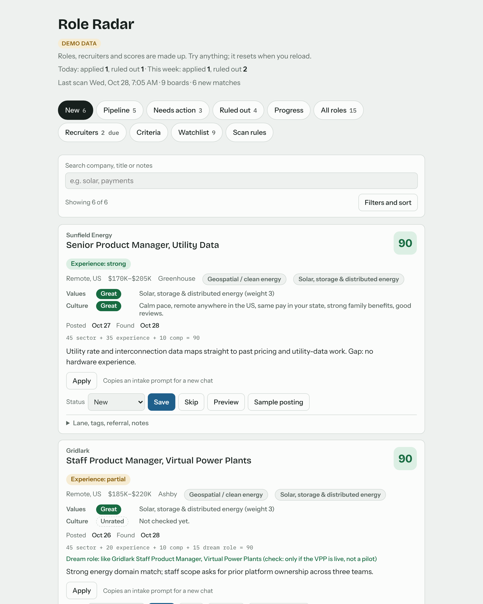

*All screenshots use fictional demo data.*

## The problem

A senior job search is a part-time job made of small chores:

- **Finding roles is a daily slog.** The companies I care about post on dozens of separate boards (Greenhouse, Ashby, Lever, Workday), plus job alerts and aggregators. Checking them by hand every morning costs time I'd rather spend on applications.
- **Search filters can't say what I actually want.** I care most about energy, solar and climate work. Fintech is fine but should rank lower, and some business models are a hard no. Keyword alerts can't express "prefer this, cap that, never show those".
- **Status lived in three places.** A spreadsheet, my inbox and my head disagreed about what I'd applied to and who I owed a follow-up.
- **Recruiter relationships went cold.** A recruiter who said "reach out if another role opens" two years ago is a warm lead, but only if I remember them.

## How it works

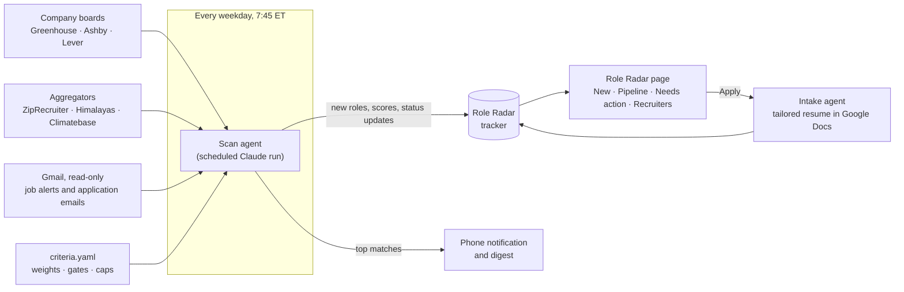

1. **Criteria as code.** Everything I'm looking for lives in one YAML file ([`criteria.yaml`](criteria.yaml)). It sets sector weights, title and location gates, comp floors, culture red flags, hard excludes, and how many roles from each sector can appear in one digest. I edit it on the Criteria tab, and the next scan follows it.
2. **A transparent score.** Every role gets 0 to 100 from one formula, and each card shows how its score was reached (`45 sector + 35 experience + 10 comp = 90`). The rules live in [`src/scoring.ts`](src/scoring.ts) and are pinned down by tests, so the page, the tests and the scan's instructions agree.
3. **A scheduled scan agent.** Each weekday morning, a scheduled Claude run reads the criteria, checks the boards and aggregators, reads job-alert and application emails (read-only), adds new matches, moves application statuses forward from confirmations and rejections, and sends me a short digest. Its instructions are in [`scan/scan-prompt.template.md`](scan/scan-prompt.template.md).
4. **One tracker.** New roles land in *New*. Saving or applying moves them to *Pipeline*. *Needs action* lists follow-ups that are due, applications with no reply, and resumes that are ready but not sent. *Ruled out* keeps every role I said no to, with the reason. *Recruiters* keeps each contact's last touchpoint and next step, and can be filled from Gmail in one pass (below).
5. **One-tap intake.** *Apply* copies a prompt for my job-intake agent, which screens the posting, asks only the gap questions that would change a bullet, and builds a tailored resume from my career master doc.
6. **Read the posting in place.** Click a role and a panel on the right shows the posting's own description, word for word, loaded straight from the company's public Greenhouse, Ashby or Lever board. It costs no AI tokens and nothing is saved; roles from other sources get an *Open posting* link instead. On a phone it opens as a full-screen sheet. The logic lives in [`src/posting.ts`](src/posting.ts).

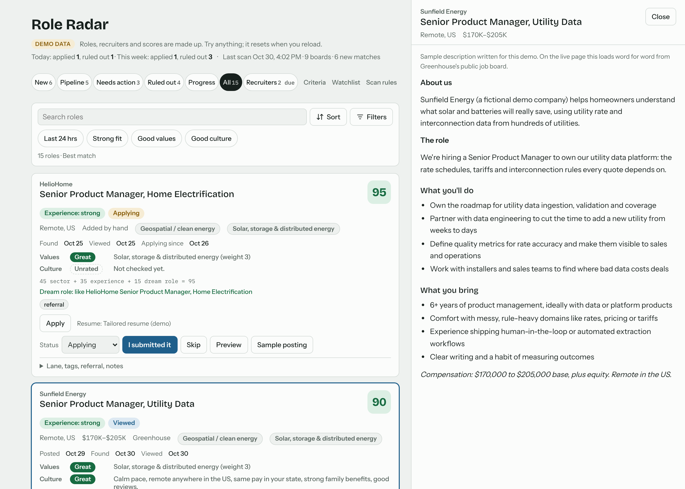

### Count the no's, not just the applications

A good search says no far more often than yes, so ruling a role out counts as progress. Skipping a role asks for a one-tap reason (comp, location, culture, closed). The *Ruled out* tab lists those roles by day with the reasons tallied, and a line at the top of every tab reads "Today: applied N, ruled out N · This week: …". *Reconsider* puts a role back in *New*.

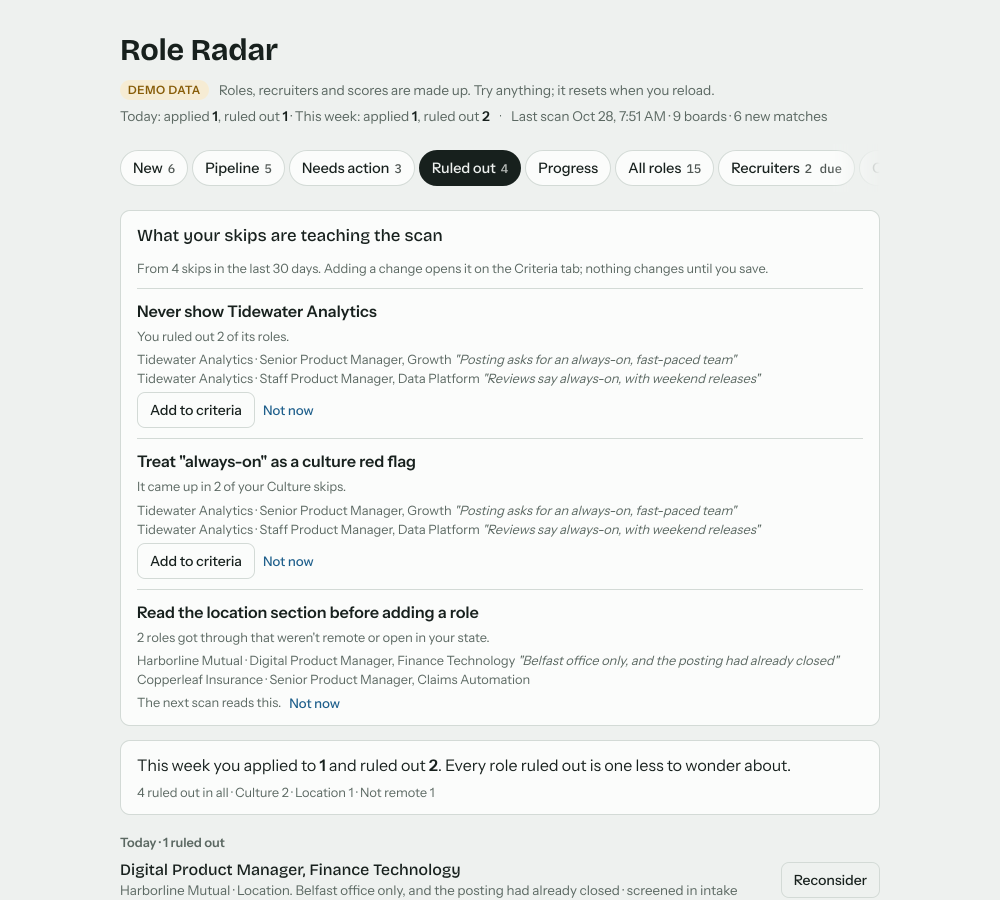

### Tune it and watch the ranking move

The Criteria tab previews tomorrow's digest while you edit. In the screenshot below, raising fintech from weight 1 to 3 moves a checkout role to the top.

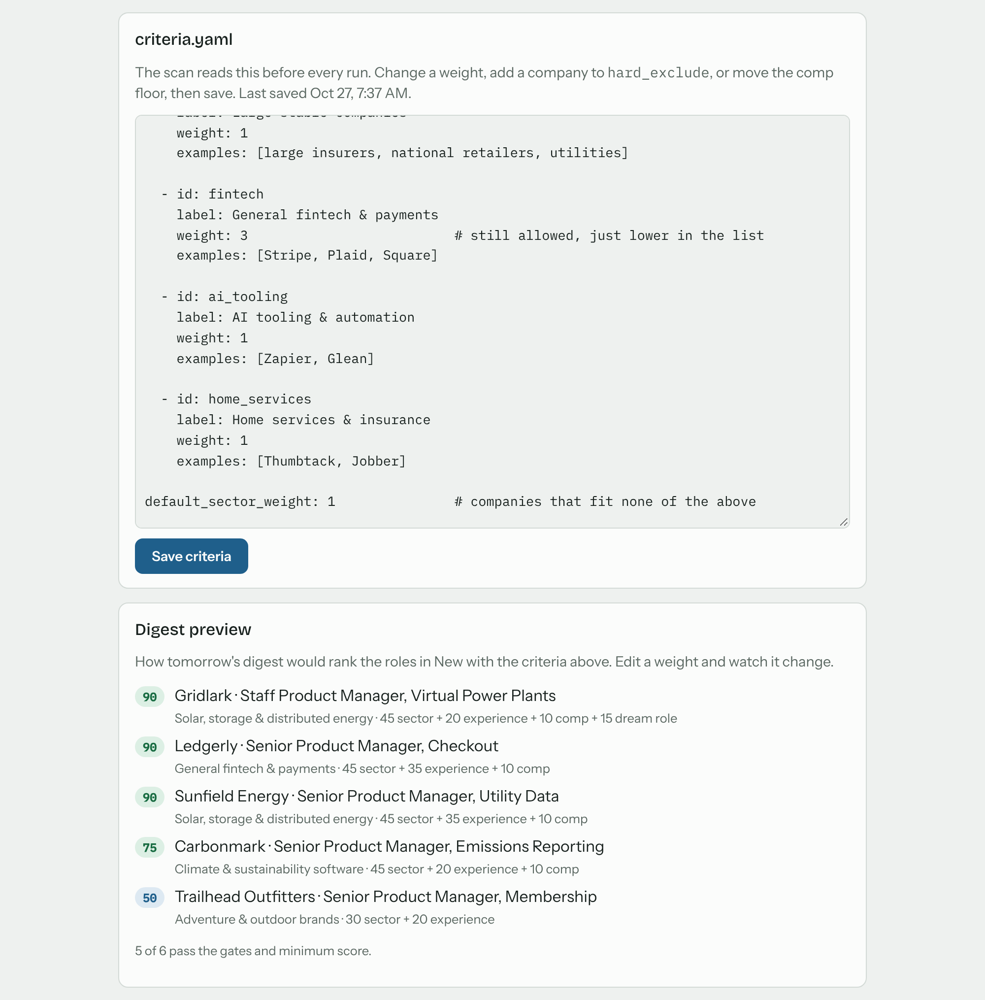

| Needs action | Recruiters |
| --- | --- |
| 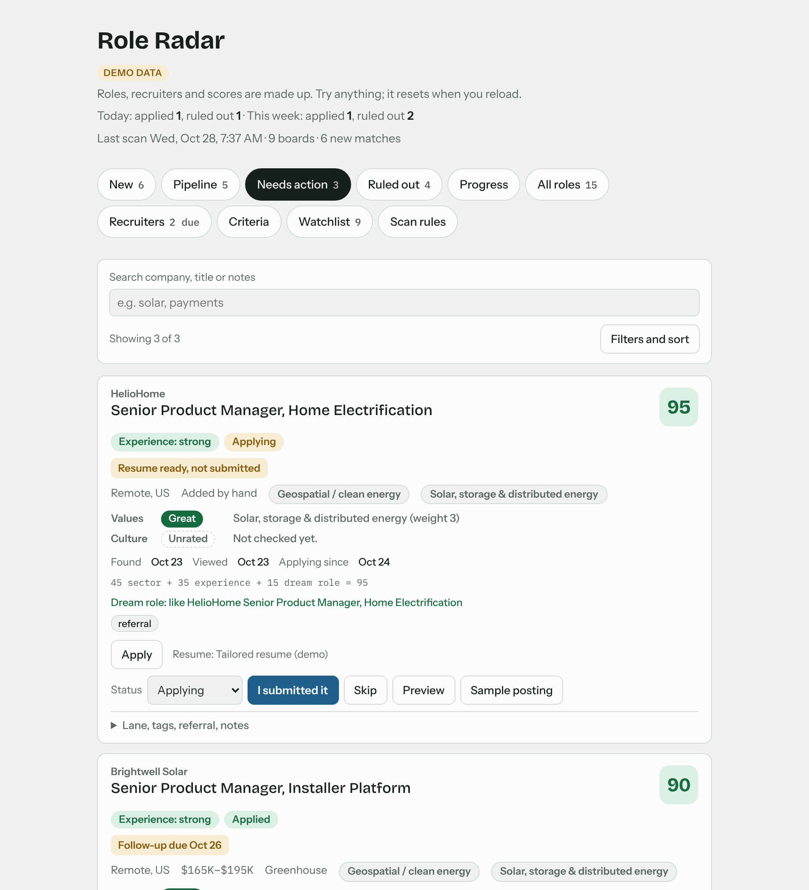 | 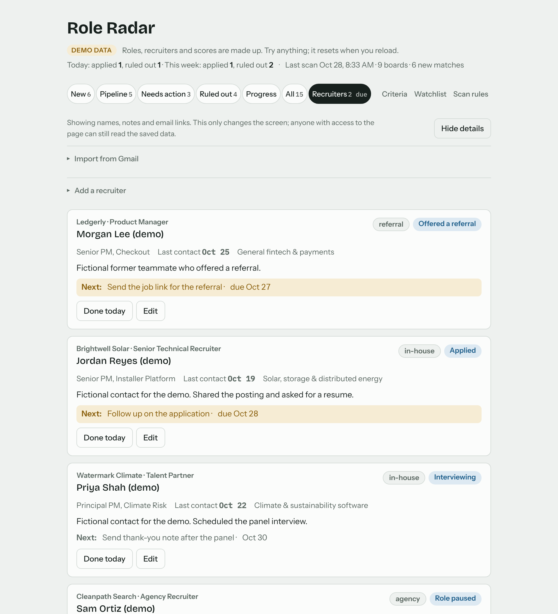 |

### Alerts you set in the same file

The `alerts:` block in `criteria.yaml` decides what pings my phone: a recruiter's reply or an interview invite right away, a rejection only in the next summary, a new role only above a score I choose, and quiet hours overnight. The Criteria tab spells out each rule in a plain sentence and previews what would ping with the roles on the page. The rules are code in [`src/alerts.ts`](src/alerts.ts), with tests.

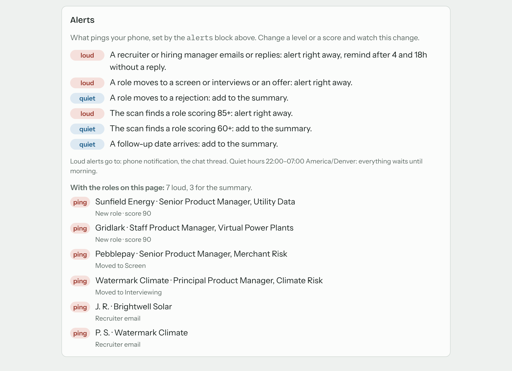

### Start from your inbox

On first run, *Import from Gmail* reads your inbox through Claude's Gmail connector (read-only) and lists the recruiters it finds: name, company, in-house or agency, and the date of the last email. It skips job boards, applicant tracking systems and no-reply senders, marks people you already have, and saves nothing until you pick who to add. Dates come from the emails themselves, never from a guess.

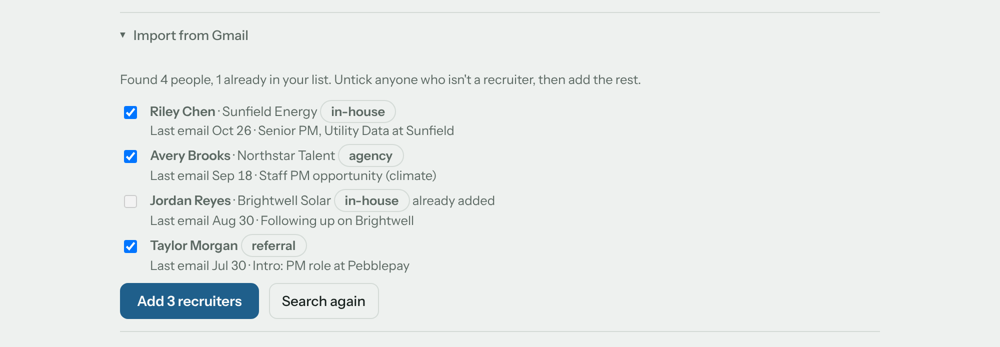

The same read-only search keeps the pipeline current. *Check Gmail for status updates* finds confirmations, interview invites, rejections and offers from the companies in the pipeline. It suggests each move with the email's own date, and nothing changes until I tick it. A role only moves forward, or to Rejected. (In the demo, the inbox is a labeled fake.)

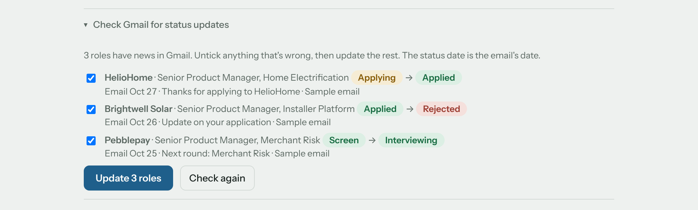

## What it saves

- **The morning search.** I no longer open job boards. The scan covers about 110 company boards plus aggregators and alert emails, and a phone notification tells me if anything is worth a look.
- **Triage time.** Roles arrive ranked by what I care about, each with a one-line reason and its score breakdown. Fintech roles still show up, but they no longer crowd out energy and climate work.
- **Status bookkeeping.** Confirmation and rejection emails update the tracker on their own, and follow-up dates are set when I mark something applied.
- **Lost leads.** Past recruiters sit next to the roles, with a next step and a due date.

## Product decisions

- **Rules over vibes.** An LLM judges fit, but the ranking itself is plain arithmetic in a file anyone can read. When a result looks wrong, I can see why and change one line.
- **Read-only by default.** The scan never applies, never sends email and never contacts anyone. Gmail access is read-only, and every status it changes can be changed back from the page.
- **Flags, not filters, for gray areas.** Culture red flags and overlaps with my own side projects lower a score or add a flag. They never hide a role.
- **Built for reuse.** Per-person settings (lanes, follow-up timing, intake prompt) live in config, the scan prompt is a template, and the demo runs on fictional data, so someone else can run their own copy.
- **Privacy first.** This repo is public, so it holds only demo data. A pre-commit check blocks emails, phone numbers, private links and a private list of names. In the app, recruiter records are readable only by the page's owner: a database rule enforces it, so anyone the tracker is shared with sees no Recruiters tab and gets no recruiter data at all ([design](docs/private-recruiters.md)). Even for the owner, names, notes and email links stay hidden on screen (initials and company only) until they choose to show them.

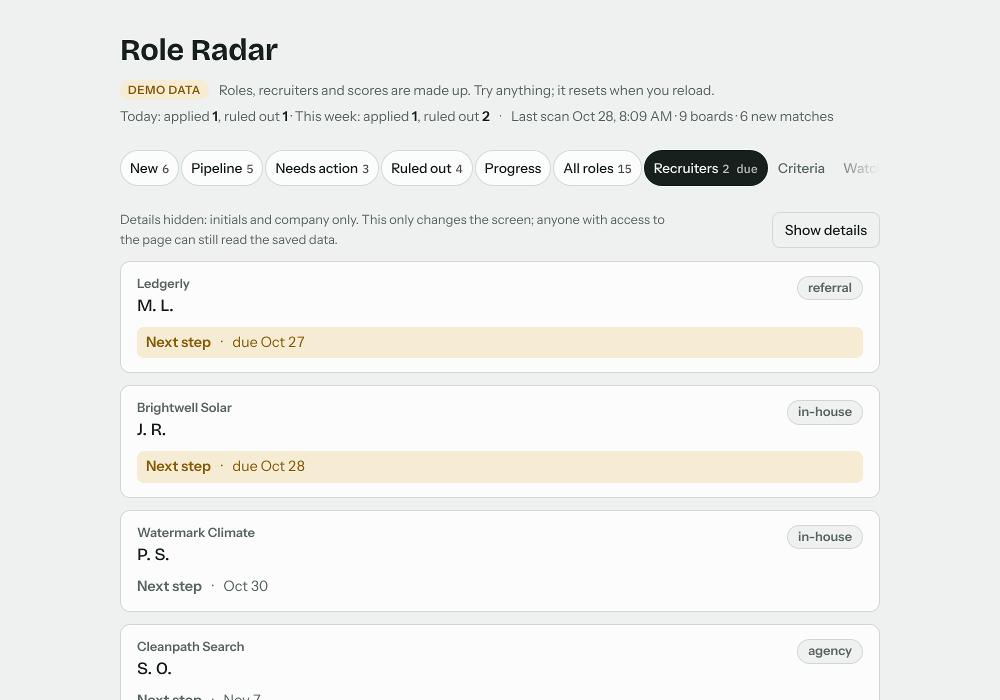

## Run the demo

**Try it in your browser:** [chaseholroyd.com/role-radar](https://chaseholroyd.com/role-radar/). All data is made up. The public demo shows the radar (scan, scores, pipeline); add [`?full`](https://chaseholroyd.com/role-radar/?full) to see the resume intake and recruiter tools too.

Or run it locally:

```sh
npm install
npm run build:demo        # writes dist/demo.html; open it in a browser
npm run typecheck         # strict TypeScript over src/ and tests/
npm test                  # unit tests plus headless-browser tests on demo data
npm run screenshots       # regenerates docs/screenshots
```

To run your own copy with your own criteria, see [docs/SETUP.md](docs/SETUP.md).

The demo runs the real page against an in-memory database ([`demo/mock-claude.js`](demo/mock-claude.js)) seeded with fictional companies and people ([`demo/seed.json`](demo/seed.json)). In production, the page is a private Claude artifact with a small database, and the scan is a scheduled Claude run.

## Use it from Claude (MCP)

A small local MCP server lets Claude score any posting against your `criteria.yaml`, right in a chat. Add it to Claude Code once:

```sh
claude mcp add role-radar -- node <path-to-repo>/mcp/server.ts
```

- `score_job`: the 0 to 100 score, its parts, and what moved it
- `match_job`: whether the role passes the hard rules (title, location, excluded companies, red flags), and which one it fails
- `explain_score`: the score with its one-line breakdown (`45 sector + 35 experience + 10 comp`)
- `get_criteria`: the criteria being used

It runs over stdio only and makes no network calls itself; what the tools return (including your criteria from `get_criteria`) goes to Claude like anything else in the chat. Criteria come from the repo's `criteria.yaml`, or from the file named in `ROLE_RADAR_CRITERIA`. Needs Node 22.18 or later.

Then paste a posting and ask: *"Score this posting for me."*

## Project layout

| Path | What it is |
| --- | --- |
| `app/role-radar.html` | The tracker page (single file; it loads the `build/*.js` scripts) |
| `src/scoring.ts` | Scoring and matching rules, shared by the page and the tests |
| `src/posting.ts` | Finds a role's public job-board API and reads its description for the preview panel |
| `src/alerts.ts` | The `alerts:` rules: what pings, how loud, quiet hours |
| `src/progress.ts` | The progress numbers: daily bar, funnel, response rate, and the daily email's report |
| `src/gmail-import.ts` | Reads Gmail search results into recruiter suggestions and pipeline status updates |
| `src/recruiter-store.ts` | The one place recruiters are read and written; owner-only |
| `src/skip-feedback.ts` | Turns the owner's recent skips into suggested criteria changes |
| `mcp/server.ts` | The local MCP server: Claude scores a job against `criteria.yaml` with `src/scoring.ts` |
| `build/` | `npm run build` output (gitignored): each `src/*.ts` bundled by esbuild into the classic script the page loads, same name and global |
| `app/capabilities.json` | What the live page may use: its database (with the owner-only recruiter rule) and read-only Gmail |
| `criteria.yaml` | Example criteria for a demo candidate |
| `scan/` | The weekday scan prompt, as a template |
| `demo/` | Fictional seed data and the in-memory database |
| `scripts/` | Bundle build, demo build, screenshots, scan-prompt renderer, privacy check |
| `tests/` | Node test runner: scoring, privacy check, demo build, Playwright UI |
| `PLAN.md`, `HANDOFF.md` | The v1 plan and the current state of work |

## What's next

- **Ask Role Radar.** Chat with the tracker: "which saved roles fit my checkout resume?"
- **Resume reuse.** For a tailored resume, find other open roles it already fits with little or no change.
- **A kit for other job seekers.** A setup guide and a blank config so friends can run their own copy.

---

Built by Chase Holroyd, a staff product manager in pricing, payments and point-of-sale lending, with Claude as the build partner. More of my work is at [chaseholroyd.com](https://chaseholroyd.com/).

## License

MIT ([LICENSE](LICENSE)). The demo companies, roles and people are fictional; any resemblance to real ones is a coincidence.
